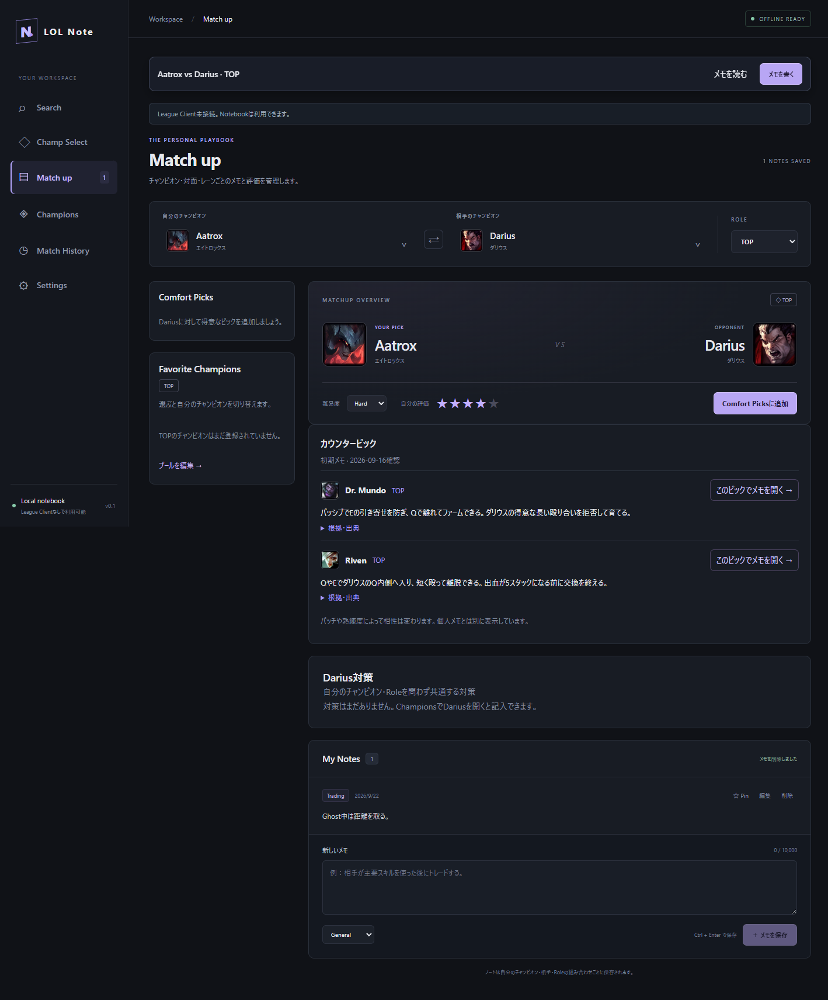
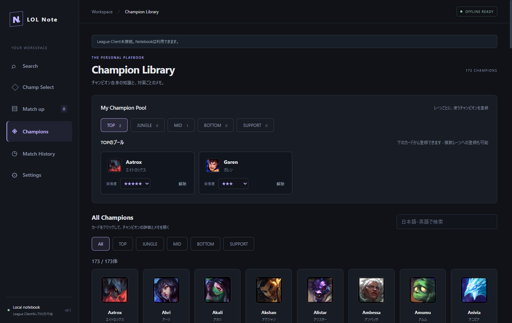
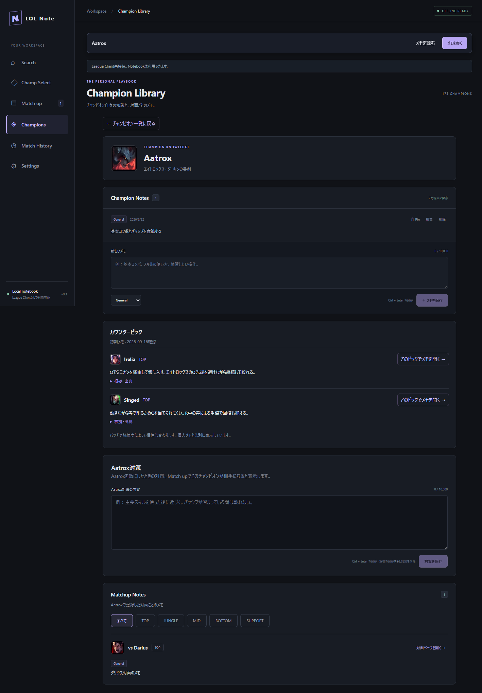
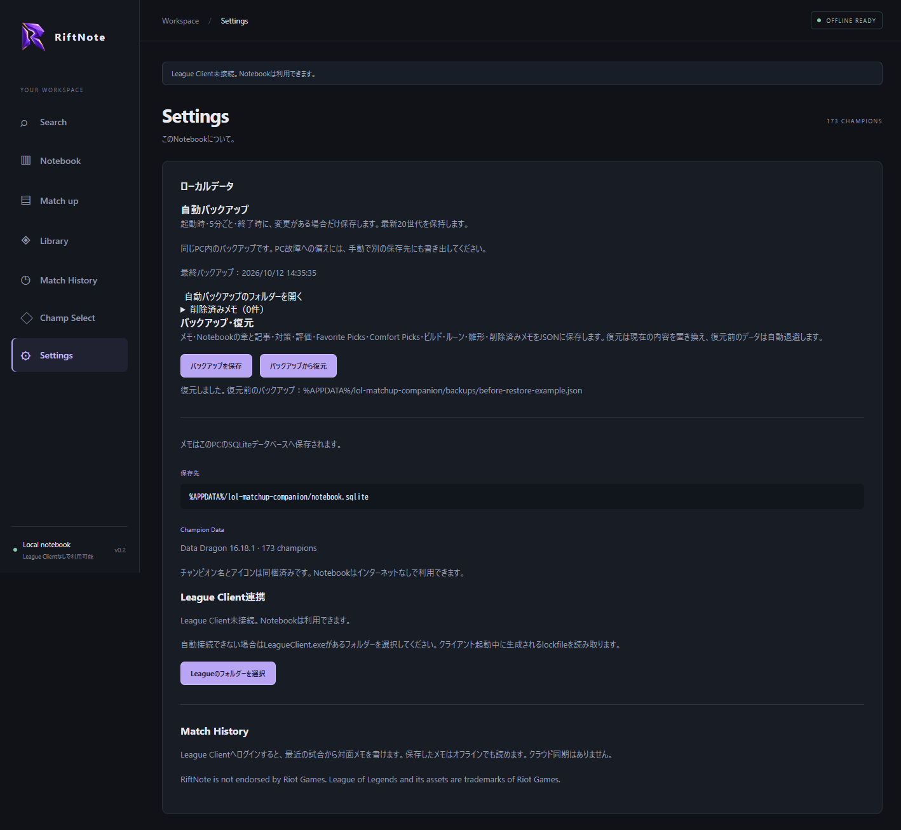
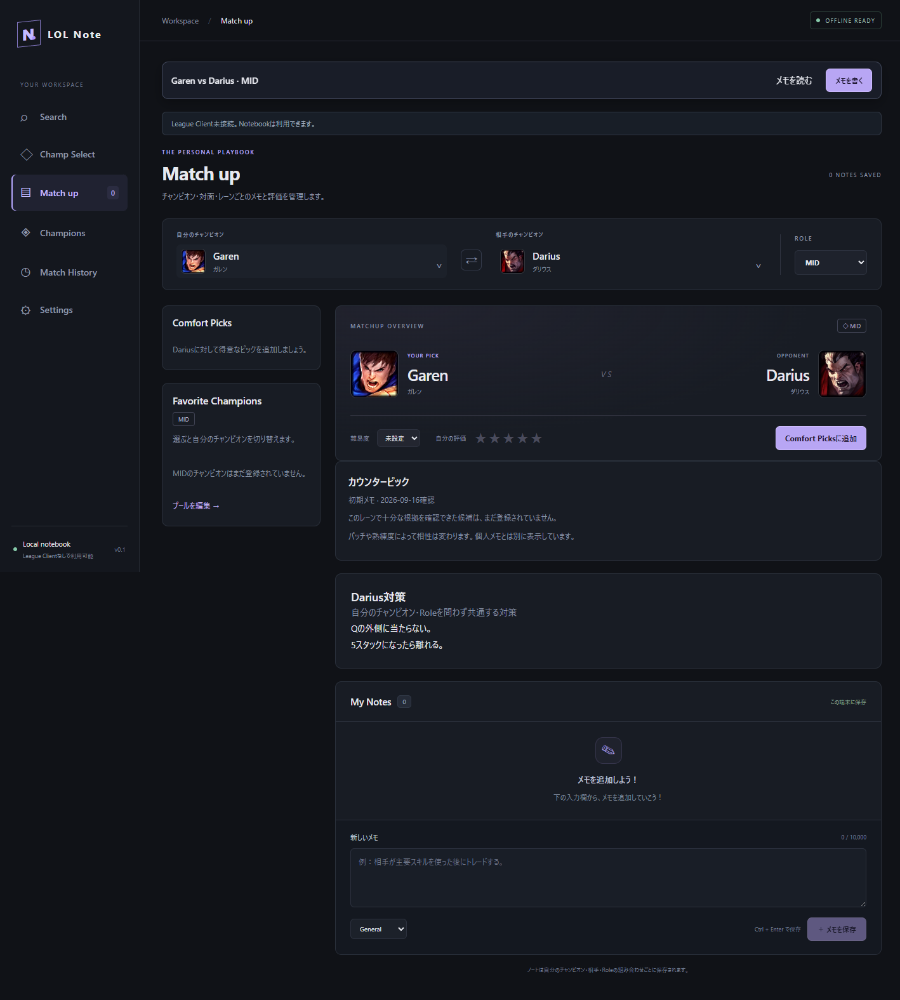
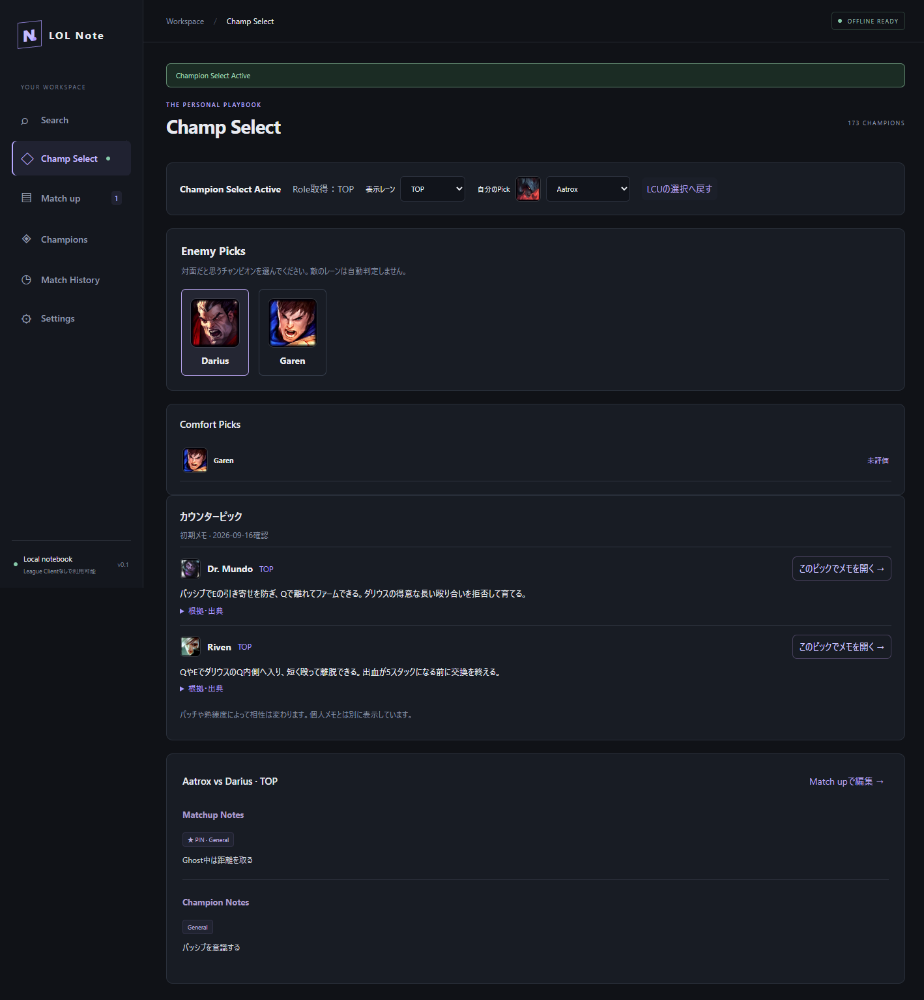
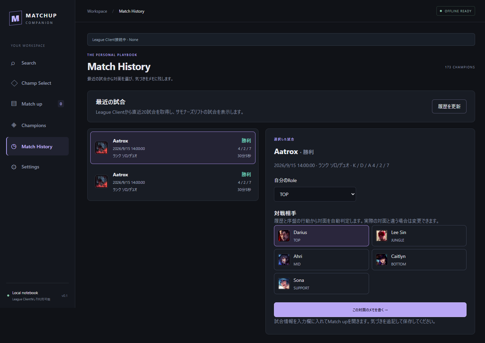

# LOL Note

試合履歴から対面を自動判定し、振り返りをメモに残せます。[使い方と判定方法](docs/match-history.md)を参照してください。

League of Legendsの対面知識を蓄積する、Windows向けの個人用Notebookです。
試合後の気づきをチャンピオン・相手・Roleごとに保存し、次の対戦前に読み返せます。



## 主な機能

- 173体のチャンピオンを日本語・英語で検索して選択
- 自分 × 相手 × RoleごとのMatchupページ
- メモの追加・編集・削除、任意カテゴリー
- 難易度・5段階評価
- 保存済みMatchup一覧とChampion / Role検索
- SQLite永続化。League Clientもネット接続も不要
- 未保存変更の確認、保存失敗時の入力保持
- Championsでチャンピオン単体のメモを追加・編集・削除
- Championsの「チャンピオン名＋対策」に敵としての対策を記入し、Match upでその敵を選ぶと自動表示
- 出典付き初期カウンターメモ：5レーンに対応、167体・197組の候補と短い理由を同梱。[選定基準・未収録範囲](docs/curated-counters.md)
- チャンピオン詳細に、保存済みの対面メモを本文付きで一覧表示
- カード形式のChampion一覧から詳細を開く
- レーン別Champion Poolへの登録・解除、自信度1〜5の保存
- Championsからチャンピオンごとの対面メモをレーンで絞り込み
- Comfort Picks：敵チャンピオン・レーンごとの候補をマッチアップの「自分の評価」順に表示
- メモ横断検索：日英Champion名・本文・Role・Category、スペース区切りAND検索
- 単体メモ・対面メモのPinと上位表示
- LCU自動接続・Champion Select検知、Role・確認できる敵Pickの取得
- 手動の対面選択から、同じComfort Picksと保存済みメモを参照
- Match Historyから最近の試合を表示し、Role・対戦相手の自動判定から対面メモを作成

初期データに個人メモは挿入しません。画像のメモはE2Eテストで入力した例です。

## Windows版のインストール

`LOL-Note-Setup-0.1.0-x64.exe` を実行し、画面に従ってインストールします。Windows x64向けです。Node.jsやnpmは不要で、スタートメニューまたはデスクトップの「LOL Note」から起動できます。

現在のビルドは署名なしです。Windowsの警告が表示される場合があります。インストーラーの作成方法と検証範囲は[配布手順](docs/release.md)を参照してください。GitHub Releaseへの公開はまだ行っていません。

既存データは `%APPDATA%/lol-matchup-companion/notebook.sqlite` を引き継ぎます。更新やアンインストールで個人データを削除しません。

## 開発用の起動手順

Windows、Node.js 24以降、npmが必要です。初回の依存取得にはネット接続を使用します。

```powershell
npm ci
npm run dev
```

ビルド済みのアプリを起動する場合：

```powershell
npm run build
npm start
```

`npm run dist` で `dist/` にWindows x64インストーラーを生成します。

## 使用方法

上部の「メモを読む」「メモを書く」から、長いページでもメモ欄へ直接移動できます。書きかけがある場合は「書きかけのメモへ」と表示します。

チャンピオン検索はひらがな・カタカナ・全角英字に対応。Match upの選択欄では↑↓で候補を選び、Enterで決定、Escで閉じられます。Libraryの検索・レーン・スクロール位置は詳細から戻っても保持します（アプリ終了まで）。カウンター候補の「このピックでメモを開く」から、その候補×相手×レーンの対面ページへ移動できます。

1. Match up上部で自分のチャンピオン・相手・Roleを選択する。
2. 「新しいメモ」に入力して保存する。Ctrl + Enterでも保存できる。
3. ノートの「編集」「削除」から管理する。
4. 保存済みの対面は左のMy Matchupsから開く。

Championsではカード一覧からチャンピオンを選ぶと、そのチャンピオン自身のメモを直接編集できます。対面やRoleを選ぶ必要はありません。下のMatchup Notesには、そのチャンピオンを自分のPickとして記録した対面メモが並びます。「チャンピオン一覧に戻る」でカード一覧へ戻れます。

一覧上部のMy Champion Poolでレーンを選び、カードの「レーンに登録」からプールへ追加します。同じチャンピオンを複数レーンへ登録でき、自信度はレーンごとに1〜5で保存します。初期値は3です。「解除」は該当レーンのプールから外す操作で、メモは削除しません。レーンは自分の登録を表し、ゲーム全体での推奨レーンを自動分類するものではありません。

Match up左側のFavorite Championsには、選択中のRoleに登録したチャンピオンを自信度順に表示します。クリックすると相手とRoleを保ったまま自分のチャンピオンを切り替えます。「プールを編集」から同じRoleの登録画面へ移動できます。





星を再度クリックすると評価を解除できます。データはOSのアプリ保存フォルダーにある `notebook.sqlite` に保存します。具体的なパスはSettingsに表示します。クラウド同期はありません。

### バックアップ・復元

Settingsの「バックアップを保存」で、対面メモ・Champion Notes・チャンピオン対策・評価・Pin・Favorite Champions・Comfort PicksをJSONへ保存できます。

「バックアップから復元」は現在の内容を置き換えます。確認後、復元前のデータを保存先フォルダー内の `backups/` に自動退避します。不正なファイルや書き込み失敗時は既存データを保持します。Leagueのフォルダー設定、履歴、認証情報は対象外です。[形式と復元の詳細](docs/backup.md)。



### チャンピオン対策

Championsでチャンピオンを選び、Champion Notesの下にある「Darius対策」などの欄に対策を記入して保存します。自分がAatroxでもGarenでも、Dariusが敵に選ばれるとMatch upのMy Notesの上に「Darius対策」として表示されます。Roleにも依存しません。

最大10,000文字で、Ctrl + Enterでも保存できます。空欄で保存すると共通対策を削除します。Champion Notesとは別に保存され、両方を編集中でも片方の保存で他方の入力は消えません。



### Comfort Picks・Search・Pin

Matchup Overviewの評価欄右側にある「Comfort Picksに追加」で、表示中の自分Champion・相手・レーンを登録します。左側のComfort Picksから得意な対面を選べます。マッチアップの「自分の評価」を参照して星を表示し、評価の高い順（未評価は末尾）に並びます。メモのPinボタンで重要な情報を上に置けます。Searchから本文も含めて検索できます。レーンを指定すると、そのレーンの対面メモが対象になり、レーンに属さない単体メモは除外します。

### Champ Select

League Clientが起動していれば自動接続します。接続できない場合はSettingsからLeagueClient.exeのあるフォルダーを指定してください。APIキーは不要です。

Champion Select Activeの通知から画面を開き、対面だと思う敵Championを自分で選択します。自分のPickとRoleが未確定なら手動で指定できます。Comfort Picksをクリックすると候補Championのメモをプレビューできます。ゲーム側のPickやロック操作は行いません。

編集中のNotebookを自動で切り替えません。切断・Select終了・敵Pick変更時は古い対面表示をクリアします。



実際のLeague Clientに接続し、Champion Select外のphase取得を確認済みです。Champion Select中の遷移はローカルHTTPS疑似LCUで検証し、実際の選択画面で自動検知が動いたとのユーザー報告もあります。

### Match History

League ClientへログインしてMatch Historyを開き、最近の試合を選択します。履歴と序盤の位置・CS・サモナースペルからRoleと対戦相手を自動判定します。必要なら修正し、「この対面のメモを書く」から気づきを追記して保存します。

直近20試合のうちサモナーズリフトの試合が対象です。履歴取得にはLeague Clientが必要ですが、保存したメモはオフラインでも読めます。判定できない場合はRoleと相手を選べます。[判定の詳細と検証範囲](docs/match-history.md)。



## 開発・検証

```powershell
npm run build
npm test
npm run lint
npm run test:e2e
git diff --check
```

E2EはElectronウィンドウを起動します。テスト用DBは `.test-data` に作成し、通常のノートとは分離します。`docs/screenshots/notebook.png` はテストで再生成されます。

LCU E2EはGit for Windows同梱のOpenSSL（他OSはPATH上のopenssl）で一時証明書を生成します。実クライアントには接続せず、テスト用HTTPSサーバーだけで検証します。証明書・lockfile・テストDBはGit対象外です。

```powershell
npm run format
npm run data:refresh
```

`data:refresh` はRiot公式Data Dragonから最新カタログとアイコンを取得します。取得済みバージョンは `resources/champions.json` に記録します。更新後は差分・テストを確認してコミットしてください。

## 技術と構成

TypeScript / React / Electron / SQLite / Vite / CSS。型契約、実行時入力検証、トランザクションで個人ノートを保護します。

```text
src/main/         Electron起動、限定IPC、SQLite Repository
src/preload/      window.notebookのAPI公開
src/shared/       型定義と入力検証
src/renderer/     React Notebook画面
resources/        Champion ID・日英名の同梱カタログ
public/champions/ 同梱アイコン
scripts/          Data Dragon更新
tests/            Repository統合テスト、Electron E2E
docs/             設計理由、実装計画、画面
```

- [初期調査とPhase計画](docs/plan.md)
- [Architectureと責務](docs/architecture.md)
- [DB設計](docs/database.md)
- [技術選定とGit運用](docs/decisions.md)
- [Notebookの流れとテスト](docs/notebook.md)
- [LCUの構造・接続・検証範囲](docs/lcu.md)

## Git運用

大きな機能は `feature/*` で実装します。mainには起動可能な検証済みコードを統合します。
機能完成時はBuild / Test / Lint / Git diffを確認し、意味のある変更単位でコミットします。
APIキー、LCU認証情報、`.env`、個人DBはコミットしません。このPhaseはAPIキー不要です。

## Assets

Champion名・画像は [Riot Games Data Dragon](https://developer.riotgames.com/docs/lol#data-dragon) を利用しています。
LOL Note is not endorsed by Riot Games and does not reflect the views or opinions of Riot Games or anyone officially involved in producing or managing League of Legends. League of Legends and Riot Games are trademarks or registered trademarks of Riot Games, Inc.

All Championsはレーンタブと名前検索を組み合わせて絞り込めます。レーン分類は同梱データを使用し、分類未収録のチャンピオンはAllに表示します。分類元：[Meraki Analytics](https://cdn.merakianalytics.com/riot/lol/resources/latest/en-US/champions.json)。
