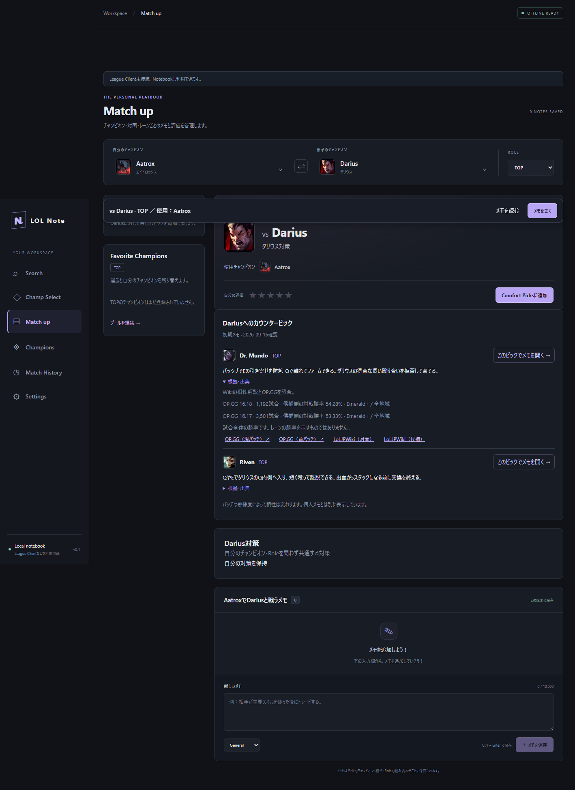

# 初期カウンターメモ

2026-09-16確認。全173体を調査対象とし、TOP / JUNGLE / MID / BOTTOM / SUPPORTのレーン別に、167体・197組を収録した。1チャンピオン・1レーンあたり最大3候補。全チャンピオンの全主要ロールを埋めたデータではない。

Match upとChamp Selectに表示し、選択中の敵とRoleで絞る。Champion Libraryでは表示しない。候補は「表示中の敵に対して選ぶチャンピオン」であり、逆方向ではない。

## 出典と選定

- [OP.GG](https://op.gg/lol/champions/darius/counters/top)：Emerald+・全地域、16.18と16.17の2パッチを照合。相手側の勝率を100から引き、候補側の勝率として記録した。数値は確認時点のスナップショットで、リンク先は更新される。
- [LoLJPWiki](https://www.loljp-wiki.jp/wiki/?cmd=read&page=Champion%2FDarius)：相性解説と両者のスキル仕様を確認。短い日本語メモは要約・考察であり、Wiki本文の転載ではない。
- 各候補に個別の両パッチのOP.GGリンクと、両チャンピオンのWikiリンクを保存。画面の「根拠・出典」から参照できる。

151組はWikiに名前付きの相性解説がある候補。各パッチ100試合以上、合計500試合以上、両パッチで候補側勝率50%超を条件とした。46組はスキル仕様から理由を説明できる候補で、画面に「考察」と明記。こちらは現パッチ300試合以上、合計1000試合以上、両パッチ50%超に加え、合算した勝率のWilson下限（95%）が50%を上回る候補に絞った。

この下限は丸められた公開勝率からの近似であり、選定の補助にすぎない。異なるパッチの合算、候補の選別、チャンピオン自体の強さ、熟練度などは補正していない。統計的な因果関係や「必ず勝てる対面」を示すものではない。試合全体の勝率はレーン勝率とは異なる。BOTは相方、JUNGLEは周回・介入・集団戦にも左右される。

## 未収録

Ahri / Elise / Fiddlesticks / Locke / Skarner / Taricは、今回の確認でサンプル数・パッチ間の一貫性・具体的な相性理由を満たす候補を選べなかったため未収録。その他のチャンピオンでも、根拠が揃わないRoleは空欄。候補のない画面には未登録と表示する。相性が存在しないという意味ではない。

## 実装と更新

- `resources/counter-notes.json` をビルド時に同梱する。メモ閲覧はオフラインで動く。出典を開くときだけ既定のブラウザーを使う。
- 統計の自動収集・定期取得・取り込み機能は追加していない。今後の更新は出典を再確認してJSONを手動で更新し、アプリを再ビルドする。
- 個人の対策・Champion Notes・Comfort Picksとは独立。SQLiteへの初期挿入や既存文章の置換はしない。個人バックアップにも含めない。
- 外部URLは同梱データの出典に完全一致したものだけMainから開く。任意のURLやローカルファイルは開けない。
- データ整合性のunit testと、オフライン表示・Role切り替え・既存メモ保持・出典の許可範囲のE2Eを用意した。

更新時はID・Role・向き・重複・最大3候補・サンプル数に加え、スキル変更とWikiの相性記述を再確認する。既存の個人メモを配布データに転記しない。
