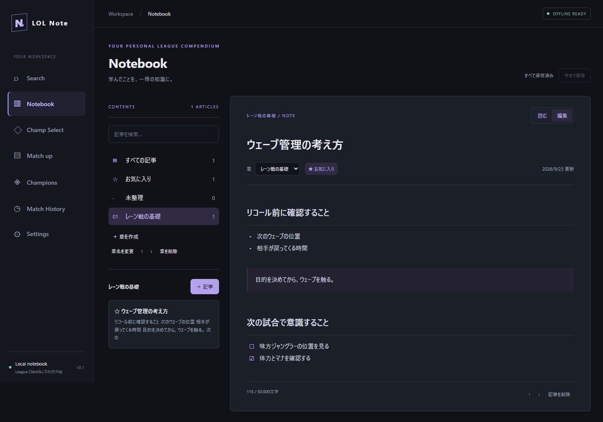

# ノートブック

チャンピオンや対面と独立して、LoLの知識を「章 → 記事」でまとめる画面。サイドバーのSearch直下にある「Notebook」から開く。他画面と同じダーク背景・紫のアクセント・共通フォントで表示する。

## 使い方

1. 「章を作成」でレーン戦、マクロ、自分の課題などの章を作る。章がなくても「未整理」に書ける。
2. 「＋ 記事」でタイトルと本文を入力。記事の章は後から変更できる。
3. 書式ボタンで見出し・箇条書き・チェックリスト・要点を追加。「読む」で整形した本文を表示する。
4. お気に入り、全文検索、↑↓での章・記事の並べ替えを使って整理する。検索はノートブック内のタイトルと本文が対象。

書式は行頭の `# ` / `## ` / `### `、`- `、`- [ ] ` / `- [x] `、`> ` のみ対応する。完全なMarkdownではない。チェックの切り替えは編集時に `[ ]` を `[x]` にする。HTMLはテキストとして表示し実行しない。画像添付・リンクのクリック・ドラッグでの並べ替えは今回の試作に含めない。

## 保存

- 入力が止まって約0.9秒後に自動保存。「今すぐ保存」や本文のCtrl+Enterでも保存できる。
- 保存中に続けて入力しても、保存完了後に最新の変更を保存する。保存失敗時は入力を保持し、再試行できる。
- 未保存状態で別画面へ移る際は既存の確認ダイアログを使う。確認中は自動保存を一時停止する。アプリ終了時も未保存の確認を行う。強制終了・OSの停止に対して未保存の入力は保証しない。
- 章の削除は記事を「未整理」へ移す。記事の削除は確認後に本文ごと削除する。
- 上限は章100件、記事500件、名前100文字、本文1記事50,000文字、本文合計2,000,000文字。
- DB schema v5の既存settingsテーブルに `knowledge-book` キーとして検証済みJSONを保存。個人の対面メモ・Champion Notesを更新しない。初期サンプルの挿入も行わない。
- バックアップv2に章・記事を含める。v1も読めるが、ノートブック未収録のため復元後は空になる。復元前の自動退避から戻せる。League設定は引き続きバックアップ対象外。

## 検証

保存・再起動、章の参照、重複ID・上限・型の拒否、バックアップv2往復、v1読込、復元失敗のロールバックをunit testで確認。E2Eでは章と記事の作成、自動保存、閲覧、検索、HTMLの非実行、SQLiteロック中の保存失敗と入力保持、再試行・再起動、章削除時の記事保持、小さいウィンドウでの表示を確認する。
